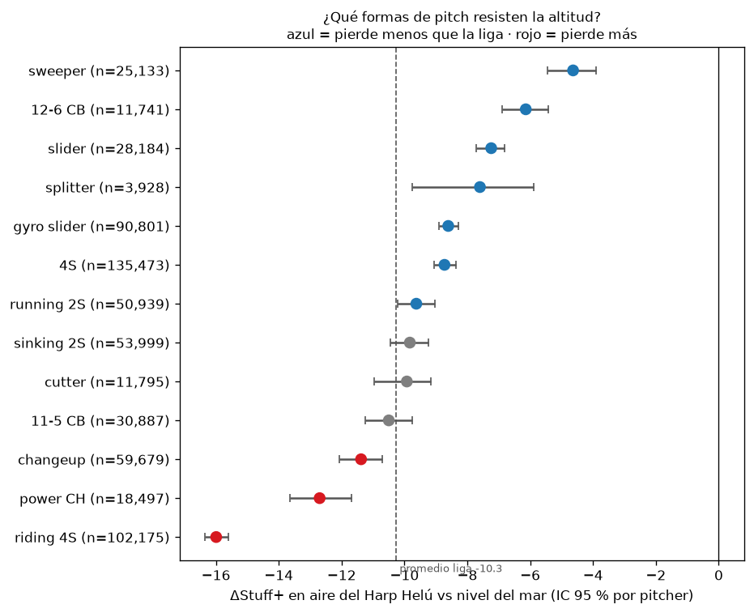

<!--
ESTADO: v2 (HACK-058): física v2, Stuff+ v2 en producción, calibración, incertidumbre y auditoría de fugas.
Cada cifra junto a un archivo de reports/ está en ese archivo: python docs/technical/check_numbers.py lo comprueba.
Presupuesto: 6–10 páginas. Compilar: python docs/technical/build_pdf.py (sin LaTeX) o bash docs/technical/build.sh.
-->

# Introducción

El Harp Helú (Ciudad de México, 2,240 m) tiene un aire más ligero que el de cualquier parque de nivel del mar. Los modelos públicos de calidad de pitcheo (Stuff+ de FanGraphs, PitchingBot, el Stuff+ de Driveline, StuffPro de Baseball Prospectus) se entrenan con datos de MLB y su descripción pública no ajusta por el aire del parque. Para un cuerpo técnico que evalúa lanzadores en la LMB, el mismo lanzamiento no vale lo mismo en dos aires distintos.

**Pregunta del reto.** ¿Cuánto vale cada lanzamiento en el aire de la CDMX, y qué perfiles conviene reclutar?

**Contribución.** *Stuff+ 2240* (i) mide la densidad del aire de cada juego con la física de las trayectorias; (ii) mide cuánto cae la fuerza de Magnus con esa densidad y la usa en un motor de vuelo; (iii) define la identidad del lanzamiento con rasgos que el aire no cambia; (iv) separa la física del resultado para responder el contrafactual *el mismo release, en el aire de la CDMX contra el de nivel del mar*; y (v) reporta todo contra el modelo nulo de la rúbrica, con calibración, intervalos bajo cambio de entorno y una auditoría de fugas.

**Resultados principales.**

- **El aire se mide.** La densidad relativa por juego es 1.001 en los parques sin altitud, 0.892 en los de altitud media y 0.841 en los de altitud extrema; para el Harp Helú usamos $\hat\rho = 0.819$ (`reports/physics/rho_by_bucket.csv`, `reports/park_id/harp_helu.md`).
- **El Magnus cae más rápido que el aire.** Dentro del mismo lanzamiento, la aceleración de Magnus de la recta escala con $\rho^{1.36}$ [1.32, 1.40], no con $\rho^1$ como en la física de libro. Con esa elasticidad el motor de vuelo predice −3.64 in de subida para la recta mediana contra −3.54 in observados (`reports/physics_v2/README.md`).
- **El mismo lanzamiento pierde 13.0 puntos de Stuff+ en el aire del Harp Helú** (promedio de las formas). La curva 12-6 y el sweeper aguantan mejor (−9.5 [−10.1, −8.9] y −9.6 [−10.2, −9.1]) y la recta de mucho *ride* es la que más pierde (−17.9 [−18.3, −17.4]) (`reports/recommendations/memo.md`).
- **Stuff+ v2 le gana al nulo por lanzamiento** en las tres particiones (+0.18 %, +0.20 % y +0.23 % de RMSE, con IC que excluyen 0); Pitching+ reduce el RMSE 3.88 % por pitcher, 3.74 % al predecir la temporada siguiente y 3.28 % al predecir la altitud extrema sin haberla visto (`reports/validation/summary.md`).
- **La física corrige el sesgo de altitud.** Entrenado sin un solo juego de altitud extrema, el nulo subestima el daño allí en +0.0109 carreras por lanzamiento; Stuff+ v2 deja +0.0018 y Pitching+ +0.0020 (`reports/validation/summary.md`).
- **Valor de negocio.** Un punto de Stuff+ vale $7.24\times10^{-4}$ carreras por lanzamiento, cada victoria cuesta 14.3 carreras en altitud extrema, y la auditoría del staff candidato proyecta 3.8 y 5.5 carreras salvadas por temporada según la franquicia (`reports/business_value/runs_per_point_direct.csv`, `reports/business_value/runs_per_win.csv`, `reports/staff_audit/runs_saved.csv`).

# Marco teórico

## Stuff+, Location+, Pitching+ y los modelos públicos

Stuff+ evalúa un lanzamiento por sus rasgos físicos (velocidad, movimiento, extensión, salida, y para los secundarios la diferencia contra la recta del lanzador). Location+ evalúa dónde y en qué conteo se lanzó, y Pitching+ combina ambos [@mcgrattan2023primer]. La familia de modelos públicos comparte la idea de predecir probabilidades de resultado y pesarlas por su valor en carreras, pero difiere en lo que ve y en la escala. La tabla resume solo métodos y escalas: no comparamos cifras, porque cada modelo predice un objetivo distinto contra un nulo distinto.

| Modelo | Qué ve | Escala | Entorno |
|---|---|---|---|
| Stuff+ de FanGraphs [@mcgrattan2023primer] | física del lanzamiento | 100 = liga, 10 puntos = 1 de por lanzamiento | no documentado |
| PitchingBot [@grove_pitchingbot] | física, conteo, ubicación, manos | 20–80 (escala de *scouting*) | no documentado |
| Stuff+ de Driveline [@driveline2021stuff] | velocidad, movimiento, ángulo de brazo, extensión | 100 = promedio de su grupo de lanzamiento | no documentado |
| StuffPro y PitchPro [@suttonbrown2024stuffpro] | física, mano del bateador y conteo; PitchPro añade ubicación | carreras por 100 lanzamientos | no documentado |
| **Stuff+ 2240** | física, arsenal y la densidad del aire del juego | 100 = LMB a nivel del mar; sabor neutral y de entorno | $\rho$ medida por juego |

: Modelos de calidad de pitcheo por método. Nuestra diferencia es el entorno, no un mejor número en su objetivo.

## Por qué el aire cambia el lanzamiento

Sobre la pelota actúan el arrastre y la fuerza de Magnus, ambos proporcionales a la densidad del aire $\rho$ [@nathan2006spin]:
$$
a_D = \tfrac{1}{2}\,\frac{\rho A}{m}\,C_D\,v^2, \qquad a_L = \tfrac{1}{2}\,\frac{\rho A}{m}\,C_L\,v^2,
$$
con $A$ el área frontal, $m$ la masa y $C_D$, $C_L$ los coeficientes de arrastre y sustentación. La desviación acumulada en un tiempo de vuelo $T$ es $\Delta x \approx \tfrac{1}{2}\,a_L\,T^2$: si $C_L$ no cambiara, el quiebre inducido caería en la misma proporción que $\rho$ (elasticidad 1). El arrastre también cae, así que la bola llega antes y más rápida. De ahí la pérdida de *ride* de la recta y la caída más corta de la curva. La separación del movimiento Magnus y no Magnus sigue a [@nathan2021hawkeye]; para la relación entre altitud y carreras, [@richardson2014altitude].

**Lo que medimos (HACK-041).** Con los coeficientes de cada lanzamiento y la densidad de cada juego, regresamos log(aceleración de Magnus) contra log($\hat\rho$) dentro del mismo lanzamiento (pitcher × temporada × identidad) entre juegos. La elasticidad es mayor que 1 en todas las familias: el $C_L$ también baja en aire delgado. El motor de vuelo RK4 del producto usa la elasticidad medida y reproduce el cambio observado mejor que la física de libro.

| Familia | Elasticidad [IC 95 %] | ΔIVB predicho, libro | ΔIVB predicho, medida | ΔIVB observado |
|---|---:|---:|---:|---:|
| Recta (4 costuras) | 1.36 [1.32, 1.40] | −2.79 in | −3.64 in | −3.54 in |
| Sinker | 1.40 [1.34, 1.47] | −1.84 in | −2.46 in | −2.23 in |
| Slider | 1.15 [1.06, 1.23] | | | |

: Elasticidad del Magnus contra la densidad y validación del vuelo en la densidad mediana de cada bucket (`reports/physics_v2/README.md`, `reports/physics_v2/magnus_elasticity.csv`, `reports/physics_v2/flight_check.csv`).

## Definición formal de las dos escalas

Sea $i$ un lanzamiento con rasgos de release y arsenal $\mathbf{z}_i$ y sea $\rho$ la densidad relativa del aire ($\rho=1$ a nivel del mar). El modelo de resultado da probabilidades $P_k(\mathbf{z}_i,\rho,c)$ de los cinco resultados $k$ (bola, strike cantado, swing fallido, foul, en juego) en el conteo $c$, y su valor $V_k(c)$ en carreras **calibrado a la LMB**. Stuff+ v2 integra el conteo con la distribución de conteos $\pi_f$ de la familia $f$ del lanzamiento en entrenamiento:
$$
\widehat{xRV}_i(\rho) \;=\; \sum_{c}\pi_{f(i)}(c)\sum_{k} P_k\!\big(\mathbf{z}_i,\rho,c\big)\,V_k(c),
$$
así que la mezcla de conteos de un pitcher no mueve su Stuff+, pero el valor de un strike sí depende del conteo. Con $\mu_0$ y $\sigma_0$ la media y la desviación estándar de $-\widehat{xRV}_i(1)$ en la LMB:
$$
\boxed{\;\text{Stuff+}^{\,N}_i = 100 + 10\,\frac{-\widehat{xRV}_i(1)-\mu_0}{\sigma_0}\;}
\qquad
\boxed{\;\text{Stuff+}^{\,E}_i(\rho) = 100 + 10\,\frac{-\widehat{xRV}_i(\rho)-\mu_0}{\sigma_0}\;}
$$
- **Neutral** ($N$): 100 = promedio de la LMB a nivel del mar.
- **Entorno** ($E$): el mismo lanzamiento a la densidad $\rho$ de un parque, con **la misma $\mu_0,\sigma_0$**; por eso no promedia 100 en un parque alto.
- **Efecto de la altitud:** $\Delta\text{Stuff+}_i=\text{Stuff+}^{E}_i(\rho_{HH})-\text{Stuff+}^{N}_i$.

Location+ y Pitching+ siguen la misma regla con sus propias entradas; toda cifra del documento indica qué sabor usa.

# Datos

- **Fuente:** datos Trackman de la LMB del reto (no se publican). 635,002 lanzamientos, 84 columnas, temporadas 2024–2026, 1,134 lanzadores, 2,127 juegos; tras la limpieza (`stuffplus.schema.clean`) quedan 627,602 filas. La variable ambiental es `altitude_category` (No / Medium / Extreme), sin identificador de estadio. No hay corredores en base: el estado base-outs se reduce a *outs × conteo*.
- **Etiquetas que cambian con el aire.** Trackman reetiqueta `AutoPitchType` según el aire: para los mismos lanzadores, el uso de etiquetas cambia hasta 3.33 pp entre altitud extrema y sin altitud. La identidad por rasgos invariantes (`pitch_id`, HACK-029, sin `SpinRate`, que sube con la altitud) lo reduce a 0.49 pp, con un piso de ruido de 0.40 pp.
- **Parques sin metadatos (HACK-003).** Comunidades de bateadores en las alineaciones [@blondel2008louvain] recuperan 20 equipos por temporada. Las dos franquicias de menor densidad no se distinguen ($P = 0.832 < 0.95$), así que se combinan: $\hat\rho=0.819$ [0.814, 0.824] en 148 juegos (`reports/park_id/harp_helu.md`). **CDMX frente a Puebla no está verificado** (IDs anónimos).

| Bucket | Juegos | $\hat\rho$ medio (de) | Carreras esperadas al iniciar la entrada | Lanzamientos |
|---|---:|---:|---:|---:|
| Sin altitud | 1,003 | 1.001 (0.044) | 0.739 | 292,377 |
| Altitud media | 509 | 0.892 (0.042) | 1.004 | 154,193 |
| Altitud extrema | 602 | 0.841 (0.033) | 1.113 | 181,032 |
| Harp Helú (franquicias 11 y 5) | 148 | 0.819 [0.814, 0.824] | – | – |

: Densidad relativa del aire y ambiente de carreras por bucket (`reports/physics/rho_by_bucket.csv`, `reports/targets/run_environment_by_altitude.csv`, `reports/park_id/harp_helu.md`).

Los valores de carrera (cambio de conteo y *linear weights* [@fangraphs_lw; @tango2008woba]) se recalculan con la LMB: anota 0.144 carreras por aparición al plato contra 0.117 de la MLB, y un jonrón vale 1.85 carreras más que un out contra 1.65; la referencia MLB es una instantánea de FanGraphs que no verificamos (`reports/targets/lmb_vs_mlb.csv`).

# Metodología

## Densidad del aire por juego y la brecha de sustentación

Del ajuste de 9 parámetros de cada trayectoria se obtienen el arrastre y la fuerza de Magnus, y de ahí $C_D$ y $C_L$. La densidad del juego se calibra con el arrastre de las rectas [@kagan2014drag]: $\hat\rho$ = mediana del $C_D$-proxy de las rectas ÷ la de los juegos sin altitud, con encogimiento hacia el parque si hay menos de 30 rectas.

**Por qué baja el $C_L$.** El $C_L$ de la recta baja 9.1 % en altitud extrema. El parámetro de giro casi no cambia y explica −0.0 %; si la densidad real fuera la barométrica (0.787) y no la calibrada (0.819), el $C_L$ calculado saldría bajo por −3.9 %; queda un residuo de −5.4 % sin explicar, que puede ser un efecto de Reynolds sobre el $C_L$ o calibración de Trackman por parque (`reports/physics_v2/README.md`). Por eso la traducción entre aires usa la elasticidad **medida** y no un modelo teórico de $C_L$, y no usamos la eficiencia de giro como criterio.

## Modelos

- **Stuff+ v2 (HACK-052, en producción desde HACK-057).** *Entradas:* velocidad, giro, eje, IVB y HB en el aire del lanzamiento, salida, extensión, ángulo de brazo, diferencias contra la recta principal, mano, familia invariante y $\rho$; el conteo (`Balls`, `Strikes`) solo valora los resultados. Sin ubicación. *Salida:* las cinco probabilidades de resultado con LightGBM multiclase [@ke2017lightgbm] y el valor del contacto; el Stuff+ integra el conteo como en §2.3.
- **Location+ (HACK-011).** Ubicación espejada al lado del brazo, conteo, lado del bateador, familia y $\rho$, sin física; centrado por conteo y familia.
- **Pitching+ (HACK-012).** Ocho probabilidades más los componentes, con física, ubicación, contexto y calidad del bateador, combinadas con mínimos cuadrados con signos restringidos sobre predicciones fuera de pliegue; se puntúa con un bateador promedio.
- **Identidad (HACK-029)** por mezcla gaussiana por lanzador sobre rasgos que el aire no cambia, y **traducción entre aires** por familia con la elasticidad medida.

**Validación cruzada.** Cinco pliegues agrupados por lanzador (semilla 2240): el modelo que puntúa a un pitcher nunca vio sus lanzamientos. Explicaciones con SHAP [@lundberg2017shap].

## Calibración (HACK-053)

Los árboles potenciados deforman las probabilidades. Probamos escalamiento por temperatura [@guo2017calibration] (un parámetro, conserva el orden) e isotónica uno contra todos, siempre **anidado**: el calibrador se ajusta con predicciones fuera de pliegue dentro del entrenamiento y nunca ve a los pitchers que evalúa. La regla, fijada antes de correr, pide que baje la log-loss sin empeorar la habilidad por lanzamiento ni el nivel pitcher. Para Stuff+ v2 la temperatura baja el ECE de 0.0068 a 0.0056 y sube la pendiente del xRV de 0.80 a 0.83; la isotónica calibra más (ECE 0.0023) pero baja la confiabilidad mitad contra mitad de 0.803 a 0.787, así que se rechaza. Resultado: temperatura para Stuff+ v2 y Location+, sin calibrar Pitching+ (`reports/calibration/README.md`).

## Auditoría de fugas (HACK-054)

El ángulo de llegada vertical (VAA) es física, pero casi toda su variación es *dónde* cruzó el plato. Agregarlo crudo sube el AUC del swing fallido de 0.642 a 0.738; netearlo de ubicación y salida lo deja en 0.672, y ver la ubicación directamente da 0.747. La ubicación y la altura de salida explican entre 66 % y 86 % de la varianza del VAA según la familia. Un AUC alto con VAA crudo mide en buena parte dónde se lanzó, así que **Stuff+ no usa VAA** (`reports/leak_audit/README.md`).

# Validación

Todo se mide contra el **modelo nulo de la rúbrica**: el xRV medio por conteo, ajustado solo con el entrenamiento de cada partición. La habilidad es la reducción del RMSE de `rv_x` contra ese nulo; los IC al 95 % remuestrean pitchers completos.

| Partición | Stuff+ v1 | Stuff+ v2 | Location+ | Pitching+ |
|---|---|---|---|---|
| Por lanzador (pliegues por pitcher) | −0.03 % [−0.06, −0.01] | **+0.18 % [+0.15, +0.21]** | +2.78 % [+2.70, +2.87] | **+3.88 % [+3.78, +4.00]** |
| Temporada siguiente | +0.01 % [−0.04, +0.06] | **+0.20 % [+0.14, +0.27]** | +2.82 % [+2.66, +2.99] | **+3.74 % [+3.54, +3.93]** |
| Altitud extrema sin verla | +0.02 % [−0.02, +0.05] | **+0.23 % [+0.18, +0.28]** | +2.35 % [+2.24, +2.45] | **+3.28 % [+3.15, +3.39]** |
| Dejando fuera cada parque (20) | +0.00 % (8/20 > 0) | – | +2.28 % (20/20 > 0) | +3.10 % (20/20 > 0) |

: Habilidad fuera de muestra contra el nulo (`reports/validation/summary.md`, `reports/stuff_v2/skill.csv`). Dejar fuera cada parque es una corrida rápida con pocos árboles (conservadora).

**Por qué v2.** Stuff+ v1 no ve el conteo, así que por lanzamiento no podía superar a un nulo que sí lo ve. Stuff+ v2 deja que el conteo valore los resultados y le gana al nulo en las tres particiones, sin perder poder a nivel pitcher:

| Prueba (5 pliegues por pitcher) | Stuff+ v1 | Stuff+ v2 |
|---|---:|---:|
| Primeros 50 lanzamientos → resto de la temporada ($r$) | 0.265 | 0.269 |
| Primeros 200 lanzamientos → resto de la temporada ($r$) | 0.306 | 0.323 |
| Confiabilidad mitad contra mitad | 0.807 | 0.803 |
| Año a año | 0.738 | 0.725 |
| Pendiente de calibración por lanzamiento (1 = ideal) | 0.69 | 0.80 |

: Stuff+ a nivel pitcher, v1 contra v2 (`reports/stuff_v2/README.md`).

La adopción tenía tres reglas fijadas de antemano. R1 (habilidad por lanzamiento) y R2 (nivel pitcher) pasan; R3 pedía que el ΔStuff+ de la liga en CDMX quedara a ±1.5 de v1 y no se cumple: −10.3 en v1 contra −12.7 en v2. Una cuarta regla, escrita antes de correrla, pregunta qué modelo predice mejor el daño real en un aire no visto: v2 deja un sesgo de +0.0018 [+0.0006, +0.0030] contra +0.0025 de v1, así que el costo mayor de v2 está más cerca de la realidad. El responsable humano adoptó v2 con esa regla (`reports/stuff_v2/README.md`).

**¿Sirve la física fuera de su rango?** Entrenando sin un solo juego de altitud extrema y prediciendo esos 181,032 lanzamientos, el sesgo (observado − predicho, carreras por lanzamiento) mide cuánto daño se subestima:

| Modelo | Sesgo en altitud extrema | vs nulo |
|---|---:|---:|
| Modelo nulo (conteo) | +0.0109 | – |
| Stuff+ con física neutralizada | +0.0059 | −46 % |
| Stuff+ sin densidad del aire | +0.0046 | −58 % |
| Stuff+ v1 (con $\rho$) | +0.0025 | −77 % |
| Pitching+ | +0.0020 | −82 % |

: Sesgo al extrapolar a un aire no visto (`reports/validation/summary.md`; ee 0.0005). Stuff+ v2 deja +0.0018 en su propia corrida (`reports/stuff_v2/altitude_bias.csv`).

Agregar $\rho$ deja el 56 % del sesgo de la misma arquitectura sin ella: el modelo aprendió cómo actúa el aire y lo extrapola (`reports/validation/summary.md`). Con 50 lanzamientos, los resultados observados del propio pitcher predicen el resto con $r$ = 0.051, muy por debajo de Stuff+ (`reports/validation/summary.md`).

## Incertidumbre bajo cambio de entorno (HACK-055)

La altitud extrema es otra distribución: un clasificador que la distingue por la física (sin la densidad) logra AUC 0.770, y el tamaño efectivo de los pesos de importancia es 45 % de los 444,065 lanzamientos de origen, suficiente para ponderar [@shimodaira2000covariate]. La validación ponderada para parecerse a la altitud extrema anticipa la caída real: Location+ pasa de +2.92 % en origen a +2.59 % ponderado, y el holdout real da +2.35 % (`reports/uncertainty/README.md`).

**Intervalos para un pitcher.** Con la primera mitad de la temporada predecimos el valor de carreras por 100 lanzamientos de la segunda mitad, con intervalos conformales al 90 % [@angelopoulos2021gentle]. Para Stuff+ el intervalo mide ±2.56 carreras por 100 lanzamientos con cobertura de 91.4 %; en los pitchers que lanzan sobre todo en altura la cobertura baja a 88.1 % (n = 84), y la versión ponderada [@tibshirani2019conformal] la sube a 92.9 % con ±2.76. El ΔStuff+ de un pitcher concreto es ruidoso: el modelo y lo observado correlacionan 0.58, y el intervalo al 90 % para el observado de un pitcher nuevo mide ±7.6 puntos, con cobertura de 93.2 % (`reports/uncertainty/README.md`).

**Hipótesis físicas (HACK-009).** Comparaciones dentro del mismo lanzamiento de cada pitcher, con regla de veredicto fijada de antemano. H1 (menos quiebre en altura) se apoya: la recta pierde −4.94 [−5.08, −4.80] de quiebre total en altitud extrema y gana +3.04 por cada +0.1 de $\hat\rho$. H2 (el cambio sufre más que los rompientes) y H4 (el giro explica peor que el movimiento) se rechazan (`reports/hypotheses/summary.md`).

**H3, las rolas protegen: parcial.** Las bolas al aire viajan +36 pies [31, 41] más y el HR/FB sube +2.3 pp [1.2, 3.4], pero los pitchers rodadores no se protegen más (`reports/recommendations/memo.md`).

# Efecto de la altitud

**Evidencia física (HACK-004).** Para la recta, el efecto de altitud extrema contra sin altitud (efectos fijos por lanzador × temporada × `pitch_id`) es ΔIVB −3.54" [−3.60, −3.46] y ΔHB −1.15", y llega +1.30 mph más rápida; la curva *pierde caída*: ΔIVB +1.58" [+1.43, +1.74] (`reports/physics/README.md`).

**ΔStuff+ por forma (HACK-015, Stuff+ v2).** Cada lanzamiento de la LMB se traslada del aire en que se lanzó al nivel del mar y al aire del Harp Helú ($\rho_{HH}=0.819$) y se puntúa con la misma escala neutral. Las formas usan la familia invariante y la física, no la etiqueta de Trackman; la recta de *ride* tiene IVB de 17" o más y el cambio de poder 86 mph o más.

| Forma | Lanzamientos | ΔStuff+ [IC 95 %] | Δ HR/FB (pp) | Contra la liga |
|---|---:|---:|---:|---|
| Curva 12-6 | 11,741 | −9.5 [−10.1, −8.9] | +4.8 | pierde menos |
| Sweeper | 25,133 | −9.6 [−10.2, −9.1] | +1.0 | pierde menos |
| Slider | 28,184 | −11.0 [−11.3, −10.6] | +3.0 | pierde menos |
| Recta (4S) | 135,473 | −11.4 [−11.7, −11.0] | +3.4 | pierde menos |
| Sinker (2S hundida) | 53,999 | −11.9 [−12.4, −11.3] | +5.1 | pierde menos |
| Cambio | 59,679 | −14.4 [−15.0, −13.8] | +3.1 | pierde más |
| Cambio de poder | 18,497 | −15.6 [−16.6, −14.4] | +1.8 | pierde más |
| **Recta de *ride*** | 102,175 | **−17.9 [−18.3, −17.4]** | +3.4 | **pierde más** |

: ΔStuff+ = Stuff+ en aire del Harp Helú − Stuff+ a nivel del mar; promedio de la liga −13.0. IC por pitcher (`reports/altitude_delta/delta_by_shape.csv`, `reports/recommendations/memo.md`; 13 formas en total).

{width=70%}

**En términos absolutos todas las formas pierden.** La recta de *ride* pierde 5.3" de subida y 2.7 pp de swings fallidos: su valor depende de una subida que viene del giro. El HR/FB modelado sube en todas las formas, de +1.0 pp (sweeper) a +6.2 pp (splitter) (`reports/altitude_delta/delta_by_shape.csv`).

**Triangulación con lo observado.** Comparamos el *mismo* lanzamiento (pitcher × temporada × `pitch_id`) en juegos de altitud extrema contra juegos sin altitud. El Stuff+ del modelo se mueve en la misma dirección que el contrafactual en 7 de 7 familias; los resultados reales del pitcher caen entre −7.5 y −15.3 puntos y su IC contiene al contrafactual en 7 de 7 (`reports/altitude_delta/triangulation.csv`).

**Parque por parque.** El Stuff+ neutral va de 98.1 a 102.0 en todos los parques: los pitchers son comparables y lo que cambia es el aire. El efecto del aire va de +4.7 en el parque más denso ($\rho$ = 1.055) a −13.7 en el más ligero ($\rho$ = 0.812) (`reports/leaderboards/by_park.csv`). En el staff candidato, el ΔCDMX del modelo correlaciona 0.57 y 0.68 (por franquicia) con el delta observado de cada pitcher (`reports/staff_audit/README.md`).

# Recomendaciones y valor de negocio

**De puntos a victorias (HACK-035).** Regresamos el valor de carreras realizado contra los puntos de Stuff+ predichos fuera de pliegue: un punto vale $7.24\times10^{-4}$ carreras por lanzamiento [$6.78\times10^{-4}$, $7.69\times10^{-4}$]. El exponente pitagórico de la LMB es 1.90 [1.62, 2.15]: 11.8 carreras por victoria en la liga y 14.3 en altitud extrema, donde se anota más. +10 puntos de Stuff+ en 2,500 lanzamientos son 18.1 carreras ≈ 1.26 victorias en el Harp Helú; una desviación estándar observada entre pitcher-temporadas (5.45 puntos) vale 0.69 victorias. Esta conversión se midió con la escala de Stuff+ v1 (`reports/business_value/`).

**Perfil a reclutar (HACK-017, HACK-022).** Los umbrales salen de los quintiles de HACK-017, calculados con Stuff+ v1; las formas, de Stuff+ v2.

1. **No pagar por *ride* de recta.** El rango de Stuff+ entre IVB bajo y alto es 20.9 puntos a nivel del mar y solo 7.6 en el Harp Helú (`reports/recommendations/memo.md`).
2. **Extensión alta.** El quintil superior (6.43 ft o más) pierde 9.7 puntos y el inferior 12.8 (`reports/recommendations/memo.md`).
3. **Ángulo de llegada plano, neto de la altura de salida.** El quintil más plano pierde 9.1 puntos y el más inclinado 13.1 (`reports/recommendations/memo.md`).
4. **Secundarios.** Preferir curva 12-6, sweeper y splitter; desconfiar del cambio de poder y de la curva 11-5. Sin umbral de velocidad: su efecto no es robusto.

La diferencia de pérdida entre la recta de *ride* y el sweeper (8.3 puntos) equivale a unas 6.0 carreras por cada 1,000 lanzamientos (`reports/recommendations/memo.md`).

**Staff candidato (HACK-032).** Para las dos franquicias candidatas, siempre por separado porque la identificación es inferida: 22 de 35 y 25 de 45 pitchers tienen un lanzamiento 5 puntos o más peor en aire del Harp Helú que su mejor lanzamiento. Moverle 10 puntos de uso en casa ahorra 2.0 y 4.3 carreras por temporada, y pasar aperturas en casa al abridor más resistente a la altura suma 1.82 y 1.15. **Total: 3.8 y 5.5 carreras por temporada (0.26 y 0.38 victorias)** con los juegos en casa observados (`reports/staff_audit/README.md`).

**Tácticas en casa (hipótesis del modelo de ubicación).** El centro de la zona es lo que más se encarece en el aire del Harp Helú (recta en la zona 4: +0.027 carreras por lanzamiento) y la esquina baja del lado del guante la que mejor aguanta (+0.006) (`reports/location_model/altitude_by_zone.csv`).

Todo esto se consulta en el producto web: simulador 3D CDMX contra nivel del mar con el motor de vuelo medido, explicador de física, leaderboards, altitud, staff, prospectos, laboratorio de diseño y metodología.

# Alcance y fronteras

- **Fuera de alcance:** seguimiento de corredores (no está en los datos) y datos externos de MLB para entrenar.
- **Limitaciones, cada una con su evidencia:**
  1. **CDMX frente a Puebla** no se distinguen ($P = 0.832 < 0.95$, §3): $\hat\rho_{HH}$ usa las dos franquicias juntas y el staff se reporta por separado.
  2. **Residuo de sustentación sin explicar** (§4.1): por eso la traducción usa la elasticidad medida y no la eficiencia de giro.
  3. **Preparación transductiva.** Identidad, densidad por juego, referencias de arsenal y valores de carrera se estiman una vez con todos los datos; ningún paso usa el resultado de un lanzamiento como variable de ese lanzamiento y todos los modelos se ajustan solo con entrenamiento.
  4. **$\rho$ es por juego** y puede absorber rasgos del parque que viajan con la altitud; la triangulación dentro del lanzamiento y el holdout por parque acotan ese riesgo.
  5. **R3 no se cumplió.** Stuff+ v2 cambia la magnitud del efecto de la altitud (§5); se adoptó por la regla del sesgo en aire no visto, y el orden de las formas se conserva.
  6. **Escalas mezcladas en dos cifras de negocio:** la conversión a carreras y los quintiles de perfil se calcularon con Stuff+ v1 (§7).
  7. **Incertidumbre individual grande.** El intervalo del ΔStuff+ observado de un pitcher mide ±7.6 puntos (§5.1): el modelo da la expectativa, no el caso.
  8. **Las recomendaciones tácticas y de mezcla son hipótesis del modelo**, no experimentos.
- **Ética:** IDs anónimos, sin fines de apuesta, y los datos crudos nunca están en git ni en el despliegue (solo agregados).

# Referencias {-}

::: {#refs}
:::
