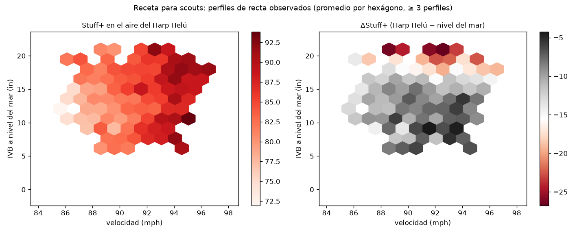

<!--
ESTADO: versión final (HACK-023). Cada cifra cita su CSV en reports/<tarea>/; lo no verificado se dice
explícitamente. Presupuesto: 6–10 páginas. Compilar: bash docs/technical/build.sh (pandoc + XeLaTeX) o
python docs/technical/build_pdf.py (sin LaTeX: HTML + navegador).
-->

# Introducción

El Harp Helú (Ciudad de México, ~2,240 m) tiene un aire más ligero que el de cualquier parque de nivel del mar. Los modelos públicos de calidad de pitcheo, como Stuff+, Location+ y Pitching+ de FanGraphs [@mcgrattan2023primer], se entrenan con datos de MLB y su descripción pública no menciona parques, altitud ni ajustes de entorno. Para un cuerpo técnico que evalúa lanzadores en la LMB, el mismo lanzamiento no vale lo mismo en dos aires distintos.

**Pregunta del reto.** ¿Cuánto vale cada lanzamiento en el aire de la CDMX, y qué perfiles conviene reclutar?

**Contribución.** *Stuff+ 2240* (i) mide la densidad del aire por juego a partir de la física de cada trayectoria, en lugar de usar una etiqueta de altitud; (ii) identifica estadios y equipos sin metadatos de parque; (iii) define la identidad del lanzamiento con rasgos que el aire no cambia; y (iv) separa un modelo físico de uno de resultado para poder responder el contrafactual *el mismo release, en el aire de la CDMX contra el de nivel del mar*.

**Resultados principales.**

- **El aire se mide.** La densidad relativa por juego, estimada del arrastre de las rectas, es 1.001 en los parques sin altitud, 0.892 en los de altitud media y 0.841 en los de altitud extrema. Para el Harp Helú usamos $\hat\rho = 0.819$.
- **El mismo lanzamiento pierde 10.3 puntos de Stuff+ en el aire del Harp Helú** (promedio de la liga). El sweeper es la forma que mejor aguanta ($-4.6$ [$-5.4$, $-3.9$]) y la recta de mucho *ride* la que más pierde ($-16.0$ [$-16.3$, $-15.6$]).
- **Validado fuera de muestra contra el modelo nulo de la rúbrica** (xRV medio por conteo). Pitching+ reduce el RMSE 3.88 % [3.78, 4.00] por pitcher, 3.74 % al predecir 2026 con 2024–25 y 3.28 % al predecir la altitud extrema sin haberla visto. Dejando fuera cada parque, la mejora es positiva en 20 de 20.
- **La física corrige el sesgo de altitud.** Entrenado sin altitud extrema, el modelo nulo subestima el daño allí en $+0.0109$ carreras por lanzamiento; Pitching+ deja $+0.0020$ (−82 %).
- **Stuff+ se estabiliza rápido.** Con 50 lanzamientos predice el resto de la temporada con $r = 0.230$, contra 0.051 de los propios resultados del pitcher. Su confiabilidad entre mitades es 0.80 y año contra año 0.71.
- **Valor de negocio.** Un punto de Stuff+ vale $7.24\times10^{-4}$ carreras por lanzamiento. Una desviación estándar entre pitcher-temporadas equivale a 0.69 victorias por temporada en el Harp Helú (14.3 carreras por victoria). La auditoría del staff candidato proyecta 4.4 y 3.2 carreras salvadas por temporada, según la franquicia.

# Marco teórico

## Stuff+, Location+ y Pitching+

Stuff+ evalúa un lanzamiento solo por sus rasgos físicos (velocidad, movimiento, extensión, ángulo de salida; los secundarios se comparan contra la recta principal del lanzador). Location+ evalúa dónde y en qué conteo se lanzó, y Pitching+ combina ambas [@mcgrattan2023primer]. En el modelo de FanGraphs, 10 puntos equivalen a una desviación estándar a nivel de lanzamiento [@mcgrattan2023primer]. Nosotros adoptamos la misma lectura de la escala (§2.3) y añadimos lo que ese modelo no documenta: el entorno.

## Por qué el aire cambia el lanzamiento

Sobre la pelota actúan el arrastre y la fuerza de Magnus, ambas proporcionales a la densidad del aire $\rho$ [@nathan2006spin]:
$$
a_D = \tfrac{1}{2}\,\frac{\rho A}{m}\,C_D\,v^2, \qquad a_L = \tfrac{1}{2}\,\frac{\rho A}{m}\,C_L\,v^2,
$$
con $A$ el área frontal, $m$ la masa, $v$ la rapidez, y $C_D$, $C_L$ los coeficientes de arrastre y sustentación. Con $C_L$ y $v$ dados, la desviación lateral o vertical acumulada en un tiempo de vuelo $T$ es aproximadamente
$$
\Delta x \;\approx\; \tfrac{1}{2}\,a_L\,T^2 \;\propto\; \rho .
$$
Si $\rho$ baja 16 %, la curvatura inducida por el giro baja en esa misma proporción, de primer orden. El arrastre también cae, de modo que el tiempo de vuelo $T$ es algo menor y la recta llega al plato con más velocidad. De ahí la pérdida de "ride" de la recta y la caída más corta de la curva.

La sustentación se relaciona con el giro mediante la eficiencia de giro $S$, con la relación empírica de Nathan $C_L = 1/(2.32 + 0.4/S)$ que usa `stuffplus/physics/aero.py` (la forma exacta no la reverificamos contra la fuente; ver [@nathan2006spin; @nathan2021hawkeye] para las mediciones y para separar el movimiento Magnus del no Magnus, y [@nathan2017allspin; @nathan2018everything] como lectura sobre componentes del giro). El planteamiento del reto afirma que el *break* de una curva de 18" baja a 14–15" en Coors (1,609 m); es la cifra del reto y no la verificamos de forma independiente. Para la relación entre altitud y carreras: [@richardson2014altitude].

## Definición formal de las dos escalas

Sea $i$ un lanzamiento con rasgos de release y arsenal $\mathbf{z}_i$ (velocidad, giro, eje, extensión, ángulo de brazo, diferencias contra la recta del lanzador, etc.) y sea $\rho$ la densidad relativa del aire, con $\rho=1$ a nivel del mar. El modelo de dos etapas es:

1. **Etapa física (A).** Movimiento esperado $\mathbf{m}_i(\rho)=f_A(\mathbf{z}_i,\rho)$ = (IVB, HB, pérdida de velocidad, velocidad al plato), ajustado con variación **intra-lanzador y por `pitch_id`**.
2. **Etapa de resultado (B).** Un valor de carreras esperado
$$
\widehat{xRV}_i(\rho) \;=\; \sum_{k\in\mathcal{K}} P_k\!\big(\mathbf{z}_i,\mathbf{m}_i(\rho),\rho\big)\, V_k ,
$$
donde $\mathcal{K}$ son los resultados del lanzamiento (strike cantado, swing y fallo, contacto por tipo, bola, etc.) y $V_k$ su valor en carreras **calibrado a la LMB** (cambio de conteo y *linear weights* [@fangraphs_lw; @tango2008woba], con `RunsScored`).

Sean $\mu_0$ y $\sigma_0$ la media y la desviación estándar de $-\widehat{xRV}_i(\rho_{\text{mar}})$ en los lanzamientos de la LMB de la temporada de referencia, evaluados a nivel del mar. Definimos
$$
\boxed{\;\text{Stuff+}^{\,N}_i \;=\; 100 + 10\,\frac{-\widehat{xRV}_i(\rho_{\text{mar}})-\mu_0}{\sigma_0}\;}
\qquad
\boxed{\;\text{Stuff+}^{\,E}_i(\rho) \;=\; 100 + 10\,\frac{-\widehat{xRV}_i(\rho)-\mu_0}{\sigma_0}\;}
$$
- **Neutral** ($N$, *park-neutral*): 100 = promedio de la LMB a nivel del mar.
- **Entorno** ($E$): el mismo lanzamiento evaluado a la densidad $\rho$ de un parque, con **la misma $\mu_0,\sigma_0$**; por eso no promedia 100 en un parque alto.
- **Efecto de la altitud:** $\Delta\text{Stuff+}_i=\text{Stuff+}^{E}_i(\rho_{HH})-\text{Stuff+}^{N}_i$, con $\rho_{HH}$ la densidad estimada del Harp Helú (`RHO_HARP_HELU`).

Location+ y Pitching+ siguen la misma regla con sus propias entradas. Location+ se centra por conteo y tipo de lanzamiento. Toda cifra del documento indica qué sabor usa.

# Datos

- **Fuente:** datos Trackman de la LMB proporcionados por el reto (no se publican). 635,002 lanzamientos, 84 columnas, temporadas 2024–2026, 1,134 lanzadores, 2,127 juegos; tras la limpieza (`stuffplus.schema.clean`) quedan 627,602 filas. La variable ambiental es `altitude_category` (No / Medium / Extreme), sin identificador de estadio.
- **Orden de los datos.** Las filas están en orden de juego y turno (el conteo no decrece en el 99.99 %), así que las secuencias son construibles. No hay corredores en base: el estado base-outs se reduce a *outs × conteo*.
- **Etiquetas de lanzamiento (label shift).** Trackman reetiqueta `AutoPitchType` según el aire. Para los mismos lanzadores, comparar Extreme con No cambia el uso de etiquetas hasta 3.33 pp (p. ej. Sinker y Changeup −2.8 pp, Cutter y Slider +2.5 pp). Una identidad basada en rasgos invariantes (`pitch_id`, HACK-029) lo reduce a 0.49 pp en `pitch_family`; el piso de ruido de la prueba de permutación es 0.40 pp, así que el margen es estrecho. `SpinRate` se excluyó de la identidad porque sube unos 17 rpm en Extreme dentro del mismo lanzamiento. Las subformas de slider siguen moviéndose más de 0.5 pp (sweeper −1.07 pp).
- **Identificación de parques (HACK-003).** Con comunidades de bateadores en las alineaciones (Louvain [@blondel2008louvain]) se recuperan 20 equipos por temporada, con pureza de altitud 1.00. Las dos franquicias de menor densidad son indistinguibles con los datos: $P$(11 menos densa que 5) = 0.832, por debajo del umbral de 0.95, por lo que se usan ambas combinadas. $\hat\rho=0.819$ (IC 95 % 0.814–0.824, 148 juegos). **La identidad CDMX frente a Puebla no está verificada** (los IDs son anónimos) y debe confirmarse con Diablos.
- **Ambiente de carreras.** La expectativa de carreras al inicio de la entrada es 0.739 (No), 1.004 (Medium) y 1.113 (Extreme) según `reports/targets/run_environment_by_altitude.csv`.

| Bucket | Juegos | $\hat\rho$ medio (de) | Carreras esperadas al iniciar la entrada | Lanzamientos |
|---|---:|---:|---:|---:|
| Sin altitud | 1,003 | 1.001 (0.044) | 0.739 | 292,377 |
| Altitud media | 509 | 0.892 (0.042) | 1.004 | 154,193 |
| Altitud extrema | 602 | 0.841 (0.033) | 1.113 | 181,032 |
| Harp Helú (franquicias 11 y 5) | 148 | 0.819 [0.814, 0.824] | — | — |

: Densidad relativa del aire y ambiente de carreras por bucket (`reports/physics/rho_by_bucket.csv`, `reports/targets/run_environment_by_altitude.csv`, `reports/park_id/harp_helu.md`).

Los valores de carrera se recalculan con la LMB. La LMB anota 0.144 carreras por aparición al plato contra 0.117 en la MLB (1.23×), y un jonrón vale 1.85 carreras más que un out contra 1.65. La referencia MLB es una instantánea de FanGraphs Guts! que **no verificamos** (`reports/targets/lmb_vs_mlb.csv`, columna `mlb_verified = False`). Por eso entrenar con pesos de MLB subvaluaría el daño en la LMB.

# Metodología

## Densidad del aire por juego
De la trayectoria ajustada de 9 parámetros se obtiene la aceleración por arrastre (a lo largo de $-\hat v$, con gravedad retirada) y la de Magnus (perpendicular a $v$). De ahí, $C_D$-proxy $=a_D/v^2$ y $C_L$-proxy $=a_L/v^2$. La densidad del juego es $\hat\rho$ = mediana del $C_D$-proxy de las rectas ÷ la de los juegos sin altitud; los juegos con menos de 30 rectas se encogen hacia su parque. Medias por bucket (`reports/physics/README.md`): 1.001 (No), 0.892 (Medium), 0.841 (Extreme).

**Advertencia.** Si ambos coeficientes fueran $\propto\rho$, el cociente $C_L/C_D$ sería constante. En los datos baja ~9 % en Extreme ($C_D$ −16 %, $C_L$ −24 %), y la eficiencia de giro cae de 0.61 a 0.52. No lo resolvimos: puede ser un efecto real (régimen de Reynolds/giro) o un artefacto de calibración de Trackman por parque. Por eso los $\Delta$ de movimiento se estiman **empíricamente** (efectos fijos por lanzador-temporada y `pitch_id`) y no con el modelo teórico de $C_L$, y no presentamos deltas de eficiencia de giro como hecho.

## Targets y valor de carreras en la LMB
Multi-target: $P$(swing), $P$(whiff), $P$(chase), $P$(strike cantado), $P$(contacto débil), $P$(rola), $P$(contacto fuerte) y el valor de carreras $xRV$, con *linear weights* y matriz de expectativa de carreras recalculados con datos LMB (no MLB). Los pesos para combinarlos salen de regresar el RV observado, no se fijan a mano.

**Por qué componentes y no una regresión directa.** El valor de carreras de un lanzamiento es casi todo ruido de bola o strike: la regresión directa del esqueleto v0 superaba al modelo por conteo en solo 0.02 %. Predecimos lo que la física sí controla y lo convertimos a carreras.

- **Stuff+ (HACK-010).** *Entradas:* velocidad, giro, eje de giro del lado del brazo, IVB y HB en el aire del lanzamiento, punto de salida, extensión, ángulo de brazo, tres diferencias contra la recta principal del lanzador, mano, familia invariante `pitch_family` y $\rho$. Sin conteo ni ubicación. *Salidas:* (1) $P$(bola, strike cantado, swing fallido, foul, en juego) con LightGBM multiclase (300 rondas, tasa 0.08, 63 hojas, ≥ 500 lanzamientos por hoja) y (2) el valor del contacto dado en juego (regresión, 200 rondas, tasa 0.05, 31 hojas). $\widehat{xRV}=\sum_k P_k V_k$, con $V_k$ el `rv_x` medio LMB de cada resultado y el modelo (2) para el contacto.
- **Location+ (HACK-011).** *Entradas:* ubicación en el plato (espejada al lado del brazo), conteo, lado del bateador, `pitch_family` y $\rho$, sin física. El valor de ubicación es $\widehat{xRV}_{loc}$ menos la media de la liga para el mismo conteo y familia, para no premiar ni castigar el conteo.
- **Pitching+ (HACK-012).** Ocho probabilidades (swing, whiff, chase, strike cantado, contacto débil, rola, contacto duro, out en la aparición) más los componentes, con física, ubicación, contexto y calidad del bateador. Se combinan con regresión de mínimos cuadrados **con signos restringidos**. Los pesos se ajustan con predicciones fuera de pliegue de los otros pliegues, así que el xRV combinado de un pliegue nunca vio sus propios resultados. Se puntúa con un **bateador promedio**. Pesos finales, en carreras por de: compuesto de componentes $+0.047$ y $P$(out) $-0.020$; los demás quedan en 0 o cerca porque su información ya está en el compuesto (`reports/pitching_model/weights.csv`).
- **Identidad del lanzamiento (HACK-029).** Mezcla gaussiana por lanzador sobre rasgos que el aire no cambia (velocidad, salida, extensión, diferencias contra la recta; sin `SpinRate`). Asigna `pitch_family` al 99.3 % de los lanzamientos (`reports/location_model/reliability.csv`); el 0.7 % restante usa la etiqueta de Trackman solo como respaldo.
- **Traducción del movimiento entre aires (HACK-004/015).** Proporcional por familia, con coeficientes estimados dentro del lanzador. ΔStuff+ puntúa el mismo lanzamiento trasladado a $\rho=1$ y a $\rho_{HH}$ con la misma regla de la escala.

**Funciones de pérdida.** Clasificadores de resultado: log-loss multiclase (*softmax*). Valor del contacto: error cuadrático sobre `rv_x`. Ocho objetivos de Pitching+: log-loss binaria. Combinación: mínimos cuadrados sobre `rv_x` con signos restringidos. Selección y reporte: RMSE de `rv_x` contra el modelo nulo, más log-loss y calibración por componente.

**Validación cruzada.** Cinco pliegues **agrupados por lanzador** (semilla 2240): el modelo que puntúa a un pitcher nunca vio sus lanzamientos. La calidad del bateador se calcula solo con el pliegue de entrenamiento.

**Ajuste de hiperparámetros (HACK-028).** Buscamos regularización y número de rondas con un conjunto interno de pitchers, solo en 2024–25. Los 14 *boosters* mejoran su pérdida por lanzamiento. Aun así, con una regla de adopción fijada antes de ver los resultados, **conservamos la configuración de producción**: el Stuff+ más regularizado calibra mejor (pendiente 0.69 → 1.09) pero distingue peor entre pitchers (confiabilidad 0.81 → 0.75) y cambia la historia de altitud (`reports/tuning/README.md`). La sobre-dispersión por lanzamiento no afecta el valor en carreras, que se estima directamente fuera de muestra (§7).

## Modelo, escala y explicación
LightGBM [@ke2017lightgbm] para la etapa de resultado, con validación agrupada por lanzador. Escala neutral/entorno según §2.3 (HACK-013). Explicaciones locales y globales con SHAP [@lundberg2017shap] (HACK-019).

# Validación

Todo se mide contra el **modelo nulo de la rúbrica**: el xRV medio por conteo (HACK-005), ajustado solo con los datos de entrenamiento de cada partición. La habilidad es la reducción del RMSE del `rv_x` contra ese nulo. Los IC al 95 % remuestrean **pitchers completos**.

| Partición | Stuff+ | Location+ | Pitching+ |
|---|---|---|---|
| Por lanzador (5 pliegues) | −0.03 % [−0.06, −0.01] | +2.78 % [+2.70, +2.87] | **+3.88 % [+3.78, +4.00]** |
| Por temporada (2024–25 → 2026) | +0.01 % [−0.04, +0.06] | +2.82 % [+2.66, +2.99] | **+3.74 % [+3.54, +3.93]** |
| Por parque (sin altitud y media → extrema) | +0.02 % [−0.02, +0.05] | +2.35 % [+2.24, +2.45] | **+3.28 % [+3.15, +3.39]** |
| Dejando fuera cada parque (20)$^\dagger$ | +0.00 % (8/20 > 0) | +2.28 % (20/20 > 0) | **+3.10 % (20/20 > 0)** |

: Habilidad fuera de muestra contra el modelo nulo (`reports/validation/summary.md`). $^\dagger$Corrida rápida con pocos árboles (conservadora); se reporta la media sobre parques.

**Cómo leer Stuff+.** Por definición del reto, Stuff+ no ve el conteo ni la ubicación, así que por lanzamiento no puede superar a un modelo que sí ve el conteo; Pitching+ y Location+ lo superan en todas las particiones. El valor de Stuff+ está a nivel pitcher:

| Prueba | Stuff+ | Pitching+ | Resultados observados |
|---|---:|---:|---:|
| Primeros 50 lanzamientos → resto de la temporada ($r$) | 0.230 | 0.238 | 0.051 |
| Primeros 200 lanzamientos → resto de la temporada ($r$) | 0.270 | 0.333 | 0.110 |
| Confiabilidad mitad contra mitad (juegos pares/impares) | 0.80 | 0.74 | 0.18 |
| Estabilidad año a año 2025 → 2026 ($r$) | 0.711 | 0.568 | — |

: Estabilidad y predicción a nivel pitcher (`reports/{stuff,pitching}_model/`, `reports/validation/official_fast/stability.csv`).

Con 50 lanzamientos, Stuff+ dice más del resto de la temporada que los resultados del propio pitcher en esos lanzamientos (0.230 contra 0.051). **Calibración:** las ocho probabilidades de Pitching+ tienen un error de calibración esperado de 0.003 a 0.017 (`reports/pitching_model/target_metrics.csv`).

**¿Sirve la física fuera de su rango?** En el *holdout* por parque, el modelo se entrena sin un solo juego de altitud extrema y predice esos 181,032 lanzamientos. El sesgo es observado − predicho en carreras por lanzamiento; un valor positivo significa que el modelo subestima el daño.

| Modelo | Sesgo en altitud extrema | vs nulo |
|---|---:|---:|
| Modelo nulo (conteo) | $+0.0109$ | — |
| Stuff+ con física neutralizada | $+0.0059$ | −46 % |
| Stuff+ sin densidad del aire | $+0.0046$ | −58 % |
| Stuff+ (con $\rho$) | $+0.0025$ | −77 % |
| Pitching+ | $+0.0020$ | **−82 %** |

: Sesgo al extrapolar a un aire no visto (`reports/validation/official_full/altitude_bias.csv`; ee ≈ 0.0005).

Agregar $\rho$ como variable deja el 56 % del sesgo de la misma arquitectura sin ella. El modelo aprendió cómo actúa el aire y lo extrapola.

**Hipótesis físicas (HACK-009).** Usamos comparaciones *dentro del mismo lanzamiento* de cada pitcher (por `pitch_id`), con IC por pitcher y dosis-respuesta contra la $\hat\rho$ de cada parque. La regla de veredicto se fijó de antemano (`reports/hypotheses/summary.md`).

| Hipótesis | Veredicto | Evidencia |
|---|---|---|
| H1: menos quiebre en altura | **Apoyada** | Recta: quiebre total $-4.94$" [$-5.08$, $-4.80$] en altitud extrema; +3.04" por cada +0.1 de $\hat\rho$. Todas las familias en la misma dirección |
| H2: el cambio de velocidad sufre más que los rompientes | Rechazada | La diferencia de diferencias (whiff, chase, xRV) incluye 0 |
| H3: las rolas protegen | Parcial | Bola al aire +36 pies [31, 41] y HR/FB +2.3 pp [1.2, 3.4]; pero los pitchers rodadores no se protegen más (la pendiente incluye 0) |
| H4: el giro explica peor que el movimiento | Rechazada | El movimiento aporta *menos* AUC sobre el giro en altura |

: Hipótesis H1–H4 con datos LMB.

# Efecto de la altitud

**Evidencia física ya medida (HACK-004).** Para la recta, el efecto Extreme − No (efectos fijos por lanzador × temporada × `pitch_id`, IC bootstrap 95 %) es $\Delta$IVB $-3.54$" [$-3.60$, $-3.46$] y $\Delta$HB $-1.15$", y llega **+1.30 mph más rápida**. La curva *pierde caída*: $\Delta$IVB $+1.58$" [$+1.43$, $+1.74$]. Los IC solo propagan la incertidumbre del coeficiente de $\rho$, no la de $\Delta\rho$ ni la de la identidad del lanzamiento.

**ΔStuff+ por forma (HACK-015).** Cada lanzamiento de la LMB se traslada del aire en que se lanzó al nivel del mar ($\rho=1$) y al aire del Harp Helú ($\rho_{HH}=0.819$), y se puntúa con la misma escala neutral. Las formas se definen con la familia invariante y la física del lanzamiento, no con la etiqueta de Trackman.

| Forma | Lanzamientos | ΔStuff+ [IC 95 %] | Δ HR/FB (pp) | Lectura |
|---|---:|---:|---:|---|
| Sweeper | 25,133 | $-4.6$ [$-5.4$, $-3.9$] | +1.0 | aguanta mejor |
| Curva 12-6 | 11,741 | $-6.1$ [$-6.9$, $-5.4$] | +4.8 | aguanta mejor |
| Slider | 28,184 | $-7.2$ [$-7.7$, $-6.8$] | +3.0 | aguanta mejor |
| Recta (4S) | 135,473 | $-8.7$ [$-9.1$, $-8.4$] | +3.4 | mejor que la liga |
| Sinker (2S hundida) | 53,999 | $-9.8$ [$-10.5$, $-9.2$] | +5.1 | como la liga |
| Cambio | 59,679 | $-11.4$ [$-12.1$, $-10.7$] | +3.1 | pierde más |
| Cambio de poder (≥ 86 mph) | 18,497 | $-12.7$ [$-13.6$, $-11.7$] | +1.8 | pierde más |
| **Recta de *ride* (IVB ≥ 17")** | 102,175 | $\mathbf{-16.0}$ [$-16.3$, $-15.6$] | +3.4 | **pierde más** |

: ΔStuff+ = Stuff+ en aire del Harp Helú − Stuff+ a nivel del mar; promedio de la liga −10.3. IC por pitcher (`reports/altitude_delta/delta_by_shape.csv`, 13 formas en total).

{width=72%}

**En términos absolutos todas las formas pierden.** La recta de *ride* pierde 5.3" de subida y 3.1 pp de swings fallidos, la mayor caída de swings fallidos de todas las formas: su valor depende de una subida que viene del giro. El HR/FB modelado sube en todas las formas, de +1.0 pp (sweeper) a +6.2 pp (splitter).

**Triangulación con lo observado.** Comparamos el *mismo* lanzamiento (pitcher × temporada × `pitch_id`) en juegos de altitud extrema contra juegos sin altitud. El Stuff+ del modelo se mueve en la misma dirección que el contrafactual en 7 de 7 familias. Los resultados reales del pitcher caen igual o más ($-7.2$ a $-14.7$ puntos) y su IC contiene al contrafactual en 6 de 7 familias. Si acaso, el modelo es **conservador** sobre el castigo de la altitud (`reports/altitude_delta/triangulation.csv`).

**Parque por parque.** El Stuff+ neutral es de 98 a 102 en todos los parques: los pitchers son comparables y lo que cambia es el aire. El efecto del aire (Stuff+ en el aire del parque menos Stuff+ neutral) va de +4.3 en el parque más denso ($\rho=1.06$) a −10.7 en el candidato más ligero ($\rho=0.81$), con correlación 0.996 contra $\rho$ (`reports/leaderboards/by_park.csv`).

**Sensibilidad por lanzador (HACK-018).** Entre 1,277 pitcher-temporadas elegibles, la pérdida en el aire del Harp Helú va de $-4.1$ a $-23.4$ puntos (media $-12.1$, de 2.8, con encogimiento empírico-bayesiano). El índice *a prueba de altitud* (100 = la pérdida de la liga) va de 88.5 a 108.0 (`reports/pitcher_sensitivity/pitchers.csv`). En el staff candidato, el ΔCDMX del modelo correlaciona 0.52 y 0.65 (por franquicia) con el delta observado de cada pitcher entre altitud extrema y sin altitud (`reports/staff_audit/README.md`).

# Recomendaciones y valor de negocio

**De puntos a victorias (HACK-035).** Regresamos el valor de carreras realizado contra los puntos de Stuff+ predichos fuera de pliegue: **un punto vale $7.24\times10^{-4}$ carreras por lanzamiento** [$6.78$, $7.69$]$\times10^{-4}$. El exponente pitagórico de la LMB es 1.90 [1.62, 2.15], lo que da 11.8 carreras por victoria en la liga y 14.3 en altitud extrema, donde se anota más. Así, +10 puntos de Stuff+ en 2,500 lanzamientos son 18.1 carreras ≈ **1.26 victorias en el Harp Helú**. Una desviación estándar observada entre pitcher-temporadas (5.4 puntos) vale 0.69 victorias (`reports/business_value/`).

**Perfil a reclutar (HACK-017, HACK-022).**

1. **No pagar por *ride* de recta.** El rango de Stuff+ entre IVB bajo y alto es de 20.9 puntos a nivel del mar y de solo 7.6 en el Harp Helú.
2. **Extensión alta.** El quintil superior (≥ 6.43 ft) pierde 9.7 puntos y el inferior 12.8.
3. **Ángulo de llegada plano, neto de la altura de salida.** El quintil más plano pierde 9.1 puntos y el más inclinado 13.1.
4. **Secundarios.** Preferir sweeper, curva 12-6 y slider; desconfiar del cambio de poder.
5. **Sin umbral de velocidad.** El efecto no es robusto entre la vía física y la total.

Recta de referencia en el Harp Helú: 90.7 mph, IVB 16.3" y HB 6.6" medidos a nivel del mar, extensión 6.25 ft, Stuff+ 108.2 en CDMX (115.5 a nivel del mar). La diferencia de pérdida entre la recta de *ride* y el sweeper (11.4 puntos) equivale a unas 8.2 carreras por cada 1,000 lanzamientos (`reports/ideal_profile/`, `reports/recommendations/memo.md`).

{width=62%}

**Staff candidato (HACK-032).** Para las dos franquicias candidatas (siempre por separado, porque la identificación es inferida):

- **Mezcla en casa.** 17 de 45 y 19 de 35 pitchers tienen un lanzamiento ≥ 5 puntos peor en aire del Harp Helú que su mejor lanzamiento. Moverle 10 puntos de uso en casa ahorra 3.0 y 1.2 carreras por temporada.
- **Asignación de aperturas.** El orden de la rotación casi no cambia entre casa y visita (Spearman 0.90 y 1.00). Lo que importa es quién abre en casa: pasar una apertura del abridor menos resistente a la altura al más resistente vale 0.45 y 0.67 carreras.
- **Total.** 4.4 y 3.2 carreras por temporada (≈ 0.30 y 0.23 victorias) con los juegos en casa observados. Con un calendario completo sería proporcionalmente más (`reports/staff_audit/`).

**Tácticas en casa (hipótesis del modelo de ubicación).** El centro de la zona es lo que más se encarece en el aire del Harp Helú (recta zona 4: +0.027 carreras por lanzamiento). La esquina baja del lado del guante es la que mejor aguanta (+0.006) (`reports/location_model/altitude_by_zone.csv`).

**Desarrollo (HACK-033).** De los ajustes coherentes que probamos, el que más gana en CDMX es +1 mph de velocidad (+0.57 puntos de Stuff+ de arsenal [0.55, 0.60]). Bajar el slot del brazo 5° vale más en CDMX que a nivel del mar (+0.08 de diferencia). Un sweeper nuevo con 10 % de uso suma +0.26 en CDMX, pero −0.36 a nivel del mar (`reports/design_lab/`).

Todo esto se consulta en el tablero interactivo: simulador CDMX contra nivel del mar, leaderboards, altitud, recomendaciones, laboratorio, tarjeta de pitcher, perfilador de prospectos y staff.

# Alcance y fronteras

- **Fuera de alcance:** seguimiento de corredores (no está en los datos) y datos externos de MLB para entrenar.
- **Limitaciones, cada una con su evidencia:**
  1. **CDMX frente a Puebla.** No se distinguen: $P = 0.832 < 0.95$ (§3). Por eso usamos las dos franquicias juntas para $\hat\rho_{HH}$ y por separado para el staff.
  2. **Brecha de eficiencia de giro sin explicar.** $C_L/C_D$ baja ~9 % en altura (§4.1), así que la traducción entre aires es empírica y no usamos la eficiencia de giro como criterio.
  3. **Preparación transductiva.** La identidad del lanzamiento, la $\hat\rho$ por juego, las referencias de arsenal y los valores de carrera LMB se estiman una vez con todos los datos. Ningún paso usa el resultado de un lanzamiento como variable de ese lanzamiento, y todos los modelos se ajustan solo con entrenamiento, pero las cifras son condicionales a esas entradas (§5).
  4. **$\rho$ es por juego.** Puede absorber rasgos del parque que viajan con la altitud. La triangulación dentro del lanzador (§6) y el *holdout* por parque acotan ese riesgo.
  5. **Stuff+ por lanzamiento empata al modelo nulo por conteo.** Es por diseño; su valor está a nivel pitcher (§5). Además está sobre-disperso por lanzamiento (pendiente de calibración 0.69), así que el valor en carreras se estima directamente (§7).
  6. **Corrida rápida en parte de la evidencia.** El *leave-one-park-out* y la estabilidad año a año usan pocos árboles: son conservadores.
  7. **Identificación de etiquetas.** Hay un piso de ~3 pp para el desplazamiento de etiquetas por lanzador individual, así que el criterio solo se evalúa agregado.
  8. **Referencia MLB sin verificar.** Los pesos de MLB se citan solo como comparación (`mlb_verified = False`).
  9. **Las recomendaciones tácticas y de mezcla son hipótesis del modelo**, no experimentos. El análisis causal exploratorio (HACK-027) está marcado como no apto para promover políticas.
- **Ética:** IDs anónimos, sin fines de apuesta, y los datos crudos nunca están en git ni en el despliegue (solo agregados).

# Referencias {-}

::: {#refs}
:::
